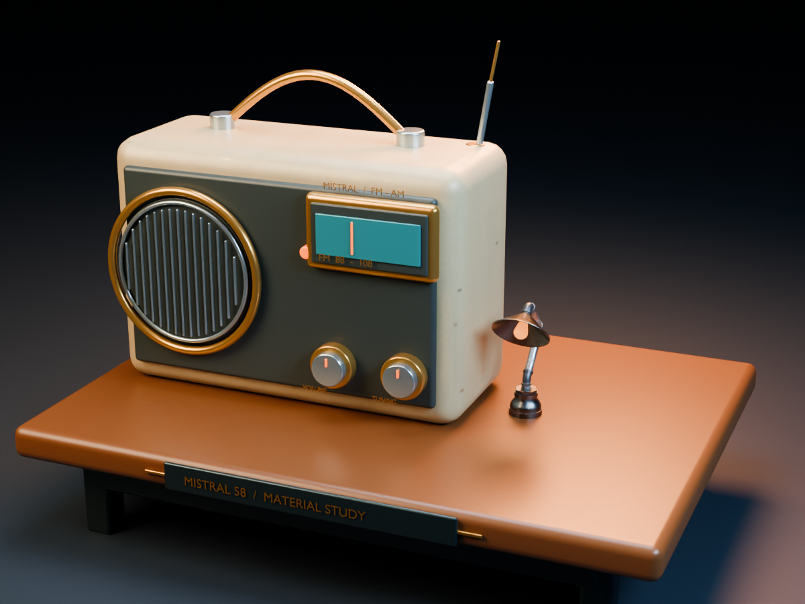

# Praktikum 10 — Blender Materials, UV & Texturing

| Data | Keterangan |
|---|---|
| Kelompok | 2 |
| Nama | Mario Napitupulu |
| NRP | 5025241085 |
| Nama | Nathanael Oliver Amadhika Yuswana |
| NRP | 5025241109 |
| Objek utama | Radio retro portabel **Mistral 58** |

**Blender:** 5.2.3 · **Engine render:** Cycles · **Resolusi:** 1200 × 900 px

## Hasil akhir

Radio Mistral 58 ditampilkan di atas meja kerja bersama lampu industri. Casing radio berwarna krem dipadukan dengan panel gelap, grille speaker, dial frekuensi, dua knob, handle, dan antena. Material logam dan kuningan memberi aksen pada detailnya.

## Scene dan objek

Radio dibuat khusus untuk tugas ini. Bentuknya mencakup casing membulat, speaker grille, dial frekuensi, layar, dua knob, tombol preset, handle, dan antena. Sebuah lampu industri dari Poly Haven melengkapi scene di atas meja kerja. Key light hangat, fill light kebiruan, rim light, dan top light membantu menampilkan bentuk serta perbedaan material. Kamera menggunakan focal length 65 mm dengan sudut pandang tiga perempat.

Model lampu eksternal: [Industrial Pipe Lamp — Poly Haven](https://polyhaven.com/a/industrial_pipe_lamp), berlisensi [CC0](https://polyhaven.com/license). Enam peta teksturnya disertakan: diffuse/base color, AO, roughness, metallic, normal OpenGL, dan emission.

## Modeling, UV, dan tekstur

Casing radio dibuat dari mesh box dengan sudut bevel. Seam ditandai pada tepi-tepi tajam, kemudian Smart UV Project menghasilkan UV map `UV_Mistral58_Smart` dan island dikemas ke bidang UV. Checker digunakan untuk memeriksa sebaran UV sebelum material final dipasang.

Enam peta casing dibuat secara prosedural pada resolusi 512 × 512 px dan tersedia di folder `textures/`:

| Peta | Color space | Fungsi |
|---|---|---|
| `radio_basecolor.png` | sRGB | Warna cat krem dan variasi permukaan |
| `radio_ao.png` | Non-Color | Ambient occlusion |
| `radio_roughness.png` | Non-Color | Kekasaran permukaan |
| `radio_metallic.png` | Non-Color | Nilai metallic |
| `radio_normal.png` | Non-Color | Detail normal melalui node Normal Map |
| `radio_emission.png` | sRGB | Mask emission |

Enam peta lampu Poly Haven juga tersedia di folder yang sama. Pada material PBR, AO dikalikan secara halus dengan base color dan peta normal diteruskan melalui node Normal Map. Speaker, dial, knob, trim, dan bagian lainnya menggunakan material terpisah agar bakelit/plastik, kaca, cat, kuningan, dan logam memiliki respons yang sesuai. Tekstur gambar disimpan di dalam file Blender agar proyek dapat dibuka tanpa mencari ulang berkas sumber.

## Cara membuka dan mendemokan

1. Buka `P10_Kelompok2_Mario_Napitupulu.blend` di Blender.
2. Tekan **Numpad 0** untuk melihat kamera. Gunakan **Material Preview** untuk melihat material.
3. Pilih `Mistral58_Body`, buka workspace **UV Editing**, masuk ke **Edit Mode**, lalu tekan **A**. Tunjukkan UV map `UV_Mistral58_Smart`. Lihat `screenshots/02_seam.png` untuk seam dan `screenshots/03_uv.png` untuk UV island final.
4. Tunjukkan `screenshots/04_checker.png` untuk menjelaskan pemeriksaan distribusi UV. Tekstur final casing menggunakan enam peta buatan sendiri.
5. Buka **Shader Editor** pada casing untuk menunjukkan base color dalam sRGB, peta data dalam Non-Color, dan peta normal yang masuk ke node Normal Map. Tunjukkan juga peta PBR pada material lampu eksternal.
6. Tunjukkan kamera dan area light, lalu buka `screenshots/05_nodes.png`. Tekan **F12** untuk merender dan **F11** untuk melihat hasil render.

Urutan presentasi: **model radio → seam dan UV → tekstur PBR buatan sendiri → lampu PBR eksternal → lighting dan kamera → hasil render**.

## Berkas proyek

- `P10_Kelompok2_Mario_Napitupulu.blend` — scene Blender beserta material dan tekstur yang dikemas di dalam file.
- `textures/` — peta tekstur radio dan lampu industri.
- `screenshots/` — dokumentasi tahapan modeling, UV, material, dan hasil akhir.

## Bukti proses

| Berkas | Keterangan |
|---|---|
| `screenshots/01_model.png` | Bentuk radio dan lampu sebelum tekstur PBR casing |
| `screenshots/02_seam.png` | Seam UV pada casing |
| `screenshots/03_uv.png` | UV layout setelah island dikemas |
| `screenshots/04_checker.png` | Pemeriksaan distribusi UV dengan checker |
| `screenshots/05_nodes.png` | Alur peta PBR ke Principled BSDF |
| `screenshots/06_final.png` | Render akhir |

## Refleksi

Tantangan utama adalah menata detail kecil radio tanpa membuat bagian depannya terlalu ramai. Speaker grille, dial, knob, dan trim dibuat terpisah agar fungsi serta material tiap bagian mudah dikenali. Seam ditempatkan pada sudut tajam casing, lalu UV diperiksa dengan checker sebelum peta tekstur dihubungkan. Perbedaan roughness dan metallic membantu membedakan tampilan casing, kuningan, dan logam. Lampu eksternal menjadi pembanding untuk material PBR dengan peta lengkap, sementara pencahayaan dan kamera menonjolkan bentuk, bayangan, serta kedalaman scene.
